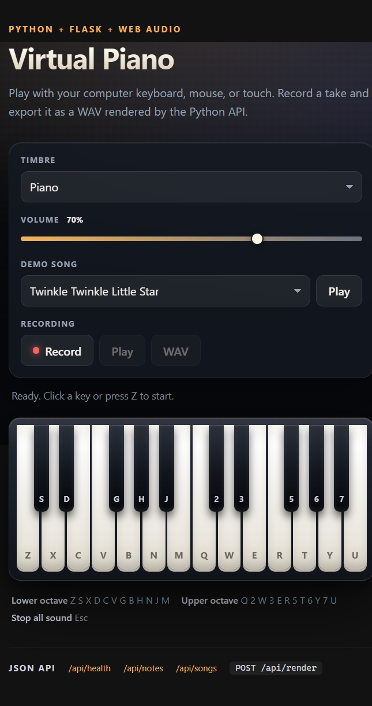

# Virtual Piano

A playable two-octave virtual piano in the browser, served by a small Python
[Flask](https://flask.palletsprojects.com/) app. Notes are synthesized live with the
[Web Audio API](https://developer.mozilla.org/en-US/docs/Web/API/Web_Audio_API), so the
project ships with no audio files. You can record a take in the browser and download it
as a WAV rendered by the Python API.



## Features

- 24 keys (C4 to B5) playable with computer keyboard, mouse, or touch
- Three timbres (piano, sine, organ), volume control, and three demo songs
- Record and play back your performance
- `POST /api/render` turns recorded notes into a downloadable 16-bit WAV
- No build step, no database, no frontend framework, one Python dependency

## Requirements

- Python 3.10 or newer
- A modern browser (Chrome, Edge, Firefox, or Safari)

## Run it in VS Code

1. Install the [Python extension for VS Code](https://marketplace.visualstudio.com/items?itemName=ms-python.python).
2. Open this folder: **File > Open Folder...**
3. Open a terminal: **Terminal > New Terminal**.
4. Create and activate a virtual environment:

   **Windows PowerShell**
   ```powershell
   python -m venv .venv
   .\.venv\Scripts\Activate.ps1
   ```

   **Windows Git Bash**
   ```bash
   python -m venv .venv
   source .venv/Scripts/activate
   ```

   **macOS / Linux**
   ```bash
   python3 -m venv .venv
   source .venv/bin/activate
   ```

5. Install dependencies:
   ```bash
   pip install -r requirements.txt
   ```
6. Select the interpreter: **Ctrl+Shift+P** > `Python: Select Interpreter` > `.venv`.
7. Start the app:
   ```bash
   python app.py
   ```
8. Open [http://127.0.0.1:5000](http://127.0.0.1:5000) in your browser.

Click or press a key once before expecting sound. Browsers keep audio suspended until
the first user gesture.

## Project structure

```
virtual-piano/
├── app.py                  # Flask app, note data, songs, JSON API
├── audio.py                # Offline additive synthesis -> WAV bytes
├── requirements.txt
├── .gitignore
├── templates/
│   └── index.html          # Server-rendered piano keyboard
└── static/
    ├── css/style.css
    └── js/piano.js         # Web Audio, input handling, recording, playback
```

## Keyboard map

| Key | Note | Key | Note | Key | Note | Key | Note |
| --- | --- | --- | --- | --- | --- | --- | --- |
| Z | C4 | S | C#4 | X | D4 | D | D#4 |
| C | E4 | V | F4 | G | F#4 | B | G4 |
| H | G#4 | N | A4 | J | A#4 | M | B4 |
| Q | C5 | 2 | C#5 | W | D5 | 3 | D#5 |
| E | E5 | R | F5 | 5 | F#5 | T | G5 |
| 6 | G#5 | Y | A5 | 7 | A#5 | U | B5 |

`Esc` stops all sound, including songs and take playback.

## JSON API

Base URL: `http://127.0.0.1:5000`

### `GET /api/health`

```bash
curl http://127.0.0.1:5000/api/health
```

```json
{ "notes": 24, "songs": 3, "status": "ok" }
```

### `GET /api/notes`

Returns every key with its MIDI number, name, frequency in Hz, computer key, and
whether it is a black key.

```bash
curl http://127.0.0.1:5000/api/notes
```

### `GET /api/songs`

Returns the built-in melodies. Each note has a `midi` number and a `beats` duration;
each song has a `bpm` value.

```bash
curl http://127.0.0.1:5000/api/songs
```

### `POST /api/render`

Renders a list of note events to a mono 22,050 Hz 16-bit WAV and returns it as a file.

Request body:

```json
{
  "notes": [
    { "midi": 60, "start": 0.0, "duration": 0.5, "velocity": 0.8 },
    { "midi": 64, "start": 0.5, "duration": 0.5, "velocity": 0.8 },
    { "midi": 67, "start": 1.0, "duration": 1.0, "velocity": 0.8 }
  ]
}
```

- `midi` (required): integer 21-108
- `start` (required): seconds from the beginning, `>= 0`
- `duration` (required): seconds, greater than 0 and at most 30
- `velocity` (optional): 0-1, defaults to `0.8`

Limits: 500 notes per request, 240 total note-seconds, 120 seconds end to end.

```bash
curl -X POST http://127.0.0.1:5000/api/render \
  -H "Content-Type: application/json" \
  -d '{"notes":[{"midi":60,"start":0,"duration":0.5},{"midi":64,"start":0.5,"duration":0.5},{"midi":67,"start":1,"duration":1}]}' \
  -o take.wav
```

Invalid input returns `400` with a JSON message:

```json
{ "error": "Note 1: 'midi' must be an integer between 21 and 108." }
```

The In-app **WAV** button calls this same endpoint with your recording.

## How the sound works

- **Browser:** each note is an oscillator (or two) with an exponential amplitude
  envelope, routed through a master gain. Starting and stopping is handled with
  `AudioContext.currentTime`, so timing stays sample-accurate.
- **Server:** `audio.py` implements simple additive synthesis. Four harmonics of the
  note frequency are mixed, each decaying at a different rate, with a short attack and
  release to avoid clicks. The result is normalized, converted to 16-bit PCM, and
  written with Python's built-in `wave` module.

## Push the project to GitHub

### 1. Create an empty repository

Open [https://github.com/new](https://github.com/new), name it `virtual-piano`, choose
Public or Private, and do **not** add a README, .gitignore, or license (the project
already has them). Copy the repository URL.

### 2. Push from the project folder

```bash
git init
git add .
git commit -m "Add virtual piano with Flask API and Web Audio frontend"
git branch -M main
git remote add origin https://github.com/<your-username>/virtual-piano.git
git push -u origin main
```

If Git asks you to sign in, use GitHub's browser login or a
[personal access token](https://docs.github.com/en/authentication/keeping-your-account-and-data-secure/managing-your-personal-access-tokens)
as the password.

### 3. Or create and push with GitHub CLI

```bash
gh auth login
gh repo create virtual-piano --public --source=. --remote=origin --push
```

Install the CLI from [cli.github.com](https://cli.github.com/).

### 4. Or use VS Code

Open the **Source Control** panel, choose **Initialize Repository**, commit the files,
then use **Publish Branch** and pick GitHub.

### Later changes

```bash
git add .
git commit -m "Describe your change"
git push
```

### Clone it elsewhere

```bash
git clone https://github.com/<your-username>/virtual-piano.git
cd virtual-piano
```

`.gitignore` already excludes `.venv/`, `__pycache__/`, and generated `*.wav` files.
If you plan to share the repository publicly, add a license on GitHub:
**Add file > Create new file**, name it `LICENSE`, and pick a template such as MIT.

## Troubleshooting

| Problem | Fix |
| --- | --- |
| No sound | Click the page once, check the tab is not muted, and raise the volume slider. |
| `ModuleNotFoundError: No module named 'flask'` | Activate `.venv` and run `pip install -r requirements.txt`. |
| Port 5000 is busy | `flask --app app run --port 5001` and open the new port. |
| Songs dropdown says unavailable | Make sure the Flask server is still running, then refresh. |
| WAV export fails | Record at least one note; the button stays disabled otherwise. |

## Reference links

- [Flask documentation](https://flask.palletsprojects.com/)
- [Flask quickstart](https://flask.palletsprojects.com/en/stable/quickstart/)
- [Web Audio API on MDN](https://developer.mozilla.org/en-US/docs/Web/API/Web_Audio_API)
- [OscillatorNode on MDN](https://developer.mozilla.org/en-US/docs/Web/API/OscillatorNode)
- [AudioContext on MDN](https://developer.mozilla.org/en-US/docs/Web/API/AudioContext)
- [Fetch API on MDN](https://developer.mozilla.org/en-US/docs/Web/API/Fetch_API)
- [Python venv documentation](https://docs.python.org/3/library/venv.html)
- [VS Code Python tutorial](https://code.visualstudio.com/docs/python/python-tutorial)
- [Create a GitHub repository](https://docs.github.com/en/repositories/creating-and-managing-repositories/creating-a-new-repository)
- [Add local code to GitHub](https://docs.github.com/en/migrations/importing-source-code/using-the-command-line-to-import-source-code/adding-locally-hosted-code-to-github)
- [GitHub CLI](https://cli.github.com/)
